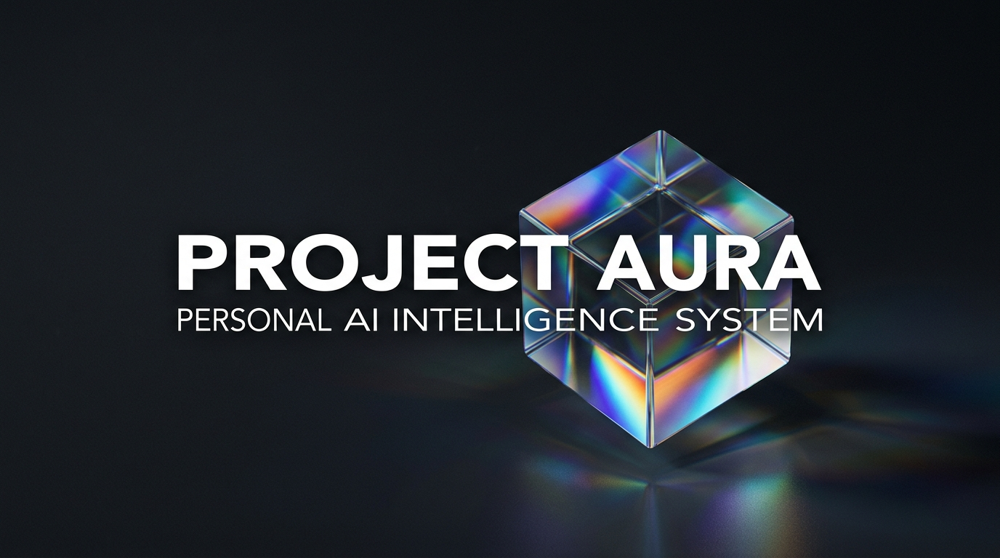
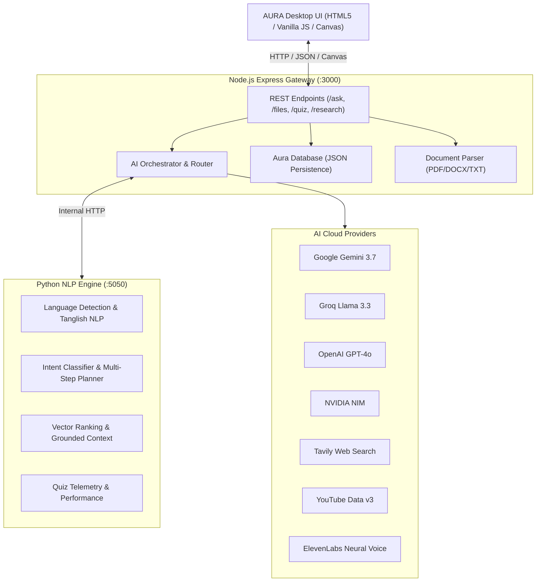

# ◈ PROJECT AURA 3.0 — AI Command Operating System

<div align="center">



**A Personal AI Command Operating System with Multi-Provider Orchestration, Persistent Cognitive Memory, Real-Time Autonomous Research, and Neural Voice Synthesis.**

[](https://nodejs.org/)
[](https://python.org/)
[](https://ai.google.dev/)
[](https://groq.com/)
[](LICENSE)

[Features](#-core-features) • [Architecture](#-architecture) • [Getting Started](#-getting-started) • [Environment Setup](#-environment-variables) • [Project Structure](#-project-structure)

</div>

---

## ✦ Overview

**PROJECT AURA 3.0** is an executive-grade **Personal AI Operating System** designed to transcend conventional chat interfaces. Rather than acting as a static chatbot, AURA serves as an autonomous cognitive cockpit capable of multi-step task planning, semantic file dissection, persistent memory recall, live web intelligence, dynamic quiz generation, and realistic voice interaction.

AURA features an Asklepios-benchmark visual architecture with a Cyber Cyan & Arctic Slate design language, liquid-metal reactive canvas core, categorized Pro Navigation Sidebar, and high-contrast Bento telemetry cards.

---

## ⚡ Core Features

### 1. ◈ Multi-Model Cognitive Orchestrator
- **Google Gemini 3.7 Flash (Default Priority)**: Lightning-fast reasoning, multimodal analysis, and comprehensive domain intelligence.
- **Groq AI (Qwen 2.5 / Llama 3.3)**: Ultra-low latency responses (<500ms) for high-frequency dispatches.
- **OpenAI GPT-4o**: Structured step-by-step logic and complex multi-tool planning.
- **NVIDIA NIM & Hugging Face**: Enterprise-grade microservice endpoints and open-weights model inference.

### 2. ◉ Memory Core (Persistent Cognition)
- Persistent JSON-backed semantic memory layer.
- Retains context, user interests, custom instructions, and historical conversation threads across sessions.

### 3. ▣ Knowledge Vault & Document Intelligence
- Full-text parsing and semantic indexing for **PDF**, **DOCX**, **TXT**, **CSV**, and **Markdown**.
- RAG (Retrieval-Augmented Generation) pipeline for deep document Q&A and cross-document synthesis.

### 4. 🌐 Deep Autonomous Web Research
- Integrated with **Tavily AI Search** for live real-time web intelligence.
- Automatically scrapes, filters, cross-checks, and synthesizes recent breakthroughs with verified source citations.

### 5. 🎓 Study Engine & ⚡ Interactive Quiz Generator
- Deep conceptual dissections for technical topics, engineering, mathematics, and algorithms.
- Dynamically creates multi-tier assessments (MCQs with explanations) and tracks accuracy telemetry in real time.

### 6. ▶ YouTube Intelligence Hub
- Curates educational lectures and technical video series using YouTube Data API v3.
- Synthesizes video transcripts into high-yield structured notes.

### 7. ✧ Creation Lab (Visual Studio)
- Clean, zero-watermark diffusion and visual asset generator.
- Generates high-definition imagery and SVG diagrams directly within the operating system.

### 8. 🎙 Neural Voice System & Cinematic Awakening
- **ElevenLabs Speech Synthesis**: High-fidelity, natural human voices.
- **Cinematic Startup Experience**: Abstract particle awakening sequence featuring sound design and authoritative AI assistant briefing.

### 9. 🎨 Executive Theme System
Includes 5 instant-switch visual themes with real-time reactive canvas shaders:
- 💠 **Cyber Cyan** (Default Executive Slate)
- 🔮 **Electric Violet**
- 🌿 **Emerald Matrix**
- ⚜️ **Obsidian Gold**
- ❄️ **Polar Light**

---

## 🏛 Architecture



---

## 🚀 Getting Started

### Prerequisites
- **Node.js**: v18.0.0 or higher
- **Python**: v3.9 or higher
- Modern web browser (Chrome, Edge, Firefox, Brave, Safari)

### 1. Clone the Repository
```bash
git clone https://github.com/your-username/project-aura-3.0.git
cd project-aura-3.0
```

### 2. Install Backend Dependencies
```bash
cd backend
npm install
cd ..
```

### 3. Configure Environment Variables
Copy `.env.example` to `backend/.env`:
```bash
cp .env.example backend/.env
```
Open `backend/.env` in your text editor and provide your API keys:
```env
PORT=3000
PYTHON_ENGINE_URL=http://127.0.0.1:5050

# At least one LLM key is required (Gemini recommended):
GEMINI_API_KEY=your_gemini_api_key_here
GROQ_API_KEY=your_groq_api_key_here
OPENAI_API_KEY=your_openai_api_key_here
TAVILY_API_KEY=your_tavily_api_key_here
ELEVENLABS_API_KEY=your_elevenlabs_api_key_here
YOUTUBE_API_KEY=your_youtube_api_key_here
```

### 4. Run Project Aura

Open two terminal windows:

**Terminal 1 — Python AI Engine (Port 5050):**
```bash
python backend/python/aura_engine/main.py
```
*(The Python Engine runs purely using standard libraries with 0 external pip dependencies required)*

**Terminal 2 — Node.js Gateway Server (Port 3000):**
```bash
node backend/server.js
```
*(Or run `npm start` from the project root)*

### 5. Access the Interface
Open your browser and navigate to:
```
http://localhost:3000
```

---

## 🔑 Environment Variables

| Variable | Provider | Purpose |
| :--- | :--- | :--- |
| `GEMINI_API_KEY` | Google Gemini | Primary conversational & multimodal engine (`gemini-3.7-flash`) |
| `GROQ_API_KEY` | Groq AI | High-speed low-latency inference (`qwen/qwen3.8-27b`) |
| `OPENAI_API_KEY` | OpenAI | Complex reasoning & multi-step workflow logic (`gpt-4o-mini`) |
| `NVIDIA_API_KEY` | NVIDIA NIM | Cloud fallback LLM inference (`meta/llama-3.1-70b-instruct`) |
| `HF_TOKEN` | Hugging Face | Open-weights model execution (`meta-llama/Llama-3.2-3B`) |
| `TAVILY_API_KEY` | Tavily | Autonomous real-time web research & citation verification |
| `ELEVENLABS_API_KEY` | ElevenLabs | Cinematic voice announcements & speech synthesis |
| `YOUTUBE_API_KEY` | Google YouTube | Educational course and lecture video indexing |

---

## 📁 Project Structure

```
project-aura-3.0/
├── assets/                       # Static media assets
│   ├── audio/                    # Startup audio & ElevenLabs neural voice samples
│   ├── images/                   # UI backgrounds, avatars & icons
│   └── project-aura/             # Branding posters & conceptual artwork
├── backend/
│   ├── python/
│   │   └── aura_engine/          # Port 5050 Python NLP & Intent Subsystem
│   │       ├── analytics.py      # Quiz scoring & learning analytics
│   │       ├── documents.py      # Document chunking & token segmentation
│   │       ├── intent.py         # Intent classification & task routing
│   │       ├── main.py           # HTTP server & endpoint dispatch
│   │       ├── nlp.py            # Natural Language Processing & Tamil transliteration
│   │       └── rag.py            # Vector scoring & grounded context builder
│   ├── routes/                   # Express API Route Handlers
│   │   ├── ai.js                 # /ask multi-agent dispatch endpoint
│   │   ├── files.js              # /files upload & vault management
│   │   ├── memory.js             # /memory context notes & history
│   │   ├── quiz.js               # /quiz generation & grading
│   │   ├── research.js           # /research Tavily autonomous search
│   │   ├── voice.js              # /voice ElevenLabs speech generation
│   │   └── youtube.js            # /youtube search & lecture curator
│   ├── services/                 # AI Provider Connectors
│   │   ├── aiRouter.js           # Intelligent fallback & provider routing
│   │   ├── gemini.js             # Google Gemini client
│   │   ├── groq.js               # Groq AI client
│   │   ├── openai.js             # OpenAI client
│   │   ├── elevenlabs.js         # ElevenLabs audio synthesis
│   │   └── tavily.js             # Tavily web crawler
│   ├── uploads/                  # Temporary file upload destination
│   │   └── creations/            # Generated diffusion images
│   ├── database.js               # Persistent JSON storage wrapper
│   ├── fileReader.js             # Multi-format document parser
│   ├── knowledgeEngine.js        # Vault semantic retrieval
│   └── server.js                 # Master Express gateway (:3000)
├── .env.example                  # Environment configuration template
├── .gitignore                    # Git ignore specifications
├── app.js                        # Master frontend application logic & state
├── index.html                    # Single-page OS interface (11 modular views)
├── LICENSE                       # MIT License
├── package.json                  # Root npm configuration & scripts
├── requirements.txt              # Python specification
├── style.css                     # Master Executive Design System stylesheet
└── README.md                     # Project documentation
```

---

## 🛡 Security & Best Practices

- **Never Commit Credentials**: Real `.env` files are excluded in `.gitignore`.
- **Sanitized Uploads**: Uploaded documents and generated artifacts are kept separate from repository source files.
- **Fail-Safe Routing**: If an AI provider experiences rate-limiting or outages, AURA automatically degrades gracefully to alternate configured providers.

---

## 📜 License

This project is licensed under the [MIT License](LICENSE) — see the LICENSE file for details.

<div align="center">
<sub>Engineered with precision for advanced personal computing. Project Aura 3.0.</sub>
</div>
